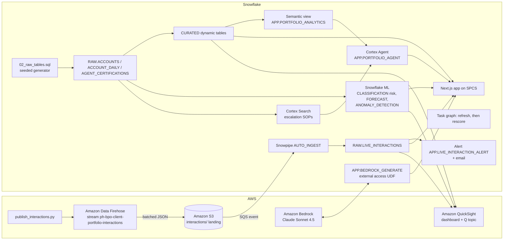

# Philippines BPO Client Portfolio - Escalations, SLA Breach Risk and Account Quality

End-to-end client portfolio analytics for **40 fictional enterprise client accounts of a fictional Philippine BPO provider, served from delivery sites in 5 cities** (Quezon City, Cebu City, Davao City, Iloilo City, Bacolod) using Snowflake, optionally with AWS: from a live escalated contact to a 7-day SLA breach risk score, an alert email and an AI action memo for the client portfolio delivery team.

## Architecture

A client-portfolio pipeline built on **Snowflake** (Dynamic Tables, Snowflake ML, Cortex Search, Cortex Agent, Cortex AI_COMPLETE, SPCS) and, in the full build, **AWS** (Amazon Data Firehose, S3, Bedrock Claude, QuickSight + Amazon Q). Contact-centre interaction events land in `RAW.LIVE_INTERACTIONS`. Dynamic tables curate 90 days of account-day history: contacts handled, billed revenue, escalations raised, SLA breaches, service credits, contacts without escalation and QA calibration audit compliance. Snowflake ML scores 7-day SLA breach risk per account, forecasts portfolio-wide escalation volume and flags repeat contact rate anomalies. A Cortex Agent answers questions with SOP citations, and an LLM drafts the delivery team's action memo.

Interactive diagrams (hover for object names): [Snowflake only](docs/architecture-snowflake.html) | [AWS + Snowflake](docs/architecture-aws.html). The app shows both on its Architecture & Data tab, the current build first. Regenerate them with `python3 docs/build_architecture.py aws` and `python3 docs/build_architecture.py snowflake`.



The Snowflake-only build drops the AWS subgraph: `APP.SIMULATE_INTERACTIONS` writes to `RAW.LIVE_INTERACTIONS`, and the app calls Cortex `AI_COMPLETE` instead of the Bedrock UDF.

## Snowflake Capabilities

| Capability | Implementation |
|-----------|---------------|
| Dynamic Tables | `CURATED.KPI_SUMMARY`, `PERFORMANCE_SUMMARY`, `ESCALATION_SUMMARY`, `TREND_ANALYSIS` from the RAW tables |
| Snowflake ML | CLASSIFICATION 7-day SLA breach risk (`ML.BREACH_RISK_SCORES`), 14-day escalation FORECAST, repeat contact rate ANOMALY_DETECTION |
| Cortex Search | 14 synthetic escalation handling SOPs (one per client vertical and escalation type) in `SEARCH.ESCALATION_SOP_SEARCH` |
| Semantic View | `APP.PORTFOLIO_ANALYTICS` over accounts, escalation types, daily totals and risk |
| Cortex Agent | `APP.PORTFOLIO_AGENT`: Cortex Analyst over the semantic view plus Cortex Search for SOP citations |
| Cortex AI | `AI_COMPLETE('claude-sonnet-4-5')` for grounded answers, and for the action memo in the Snowflake-only build |
| Alerts + Tasks | `APP.LIVE_INTERACTION_ALERT` logs ESCALATED events and sends email; task graph `TASK_REFRESH_CURATED`, then `TASK_RESCORE_RISK` |
| Snowpark Container Services | Next.js app `APP.PH_BPO_CLIENT_PORTFOLIO_APP` with 6 tabs: Executive Cockpit, Predictive, Controls, Live Interactions, Ask AI, Architecture & Data |
| Snowpipe | `RAW.LIVE_INTERACTIONS_PIPE` AUTO_INGEST from S3 (AWS build only) |

## AWS Services

Used only in the AWS + Snowflake build.

| Service | Role in Demo |
|---------|-------------|
| Amazon Data Firehose | Direct PUT stream `ph-bpo-client-portfolio-interactions` receives simulated interaction events and writes batches to S3 |
| Amazon S3 | Landing bucket (`interactions/`). An event notification goes to the Snowpipe SQS queue |
| Amazon Bedrock | Claude Sonnet 4.5 writes the action memo, called from Snowflake through an external-access UDF |
| Amazon QuickSight | DIRECT_QUERY executive dashboard over Snowflake (daily escalations, SLA breaches by account, SLA breach risk) |
| Amazon Q | Natural-language questions over the QuickSight topic `ph-bpo-client-portfolio-topic` |
| AWS IAM | Least-privilege roles for S3, Firehose and Bedrock |

## Personas

These personas are fictional.

| Persona | Role | Key Questions |
|---------|------|---------------|
| **Maricel Dizon** | Head of Client Portfolio Delivery | "What share of escalations miss the SLA?" "Which escalation types turn into service credits?" |
| **Paolo Villanueva** | Account Quality Analyst | "Which accounts are high risk this week, and which SOP applies?" |

## Data

All data is synthetic and seeded, so every rebuild reproduces it. The BPO provider, client accounts and names are fictional; the cities are real Philippine cities used as delivery-site regions.

| Table | Rows | Description |
|-------|------|-------------|
| RAW.ACCOUNTS | 40 | Client accounts served from 5 cities in 5 client verticals (Financial services, Telecommunications, Retail and e-commerce, Travel and hospitality, Technology support), with service risk tier and tenure |
| RAW.ACCOUNT_DAILY | 3,600 | Daily account observations over 90 days: contacts handled, billed revenue (PHP), escalations, SLA breaches, service credits, escalation type, QA calibration audits, repeat contact rate and average handle time |
| RAW.AGENT_CERTIFICATIONS | 40 | Agents required to hold the account certification, agents certified and agents in training, per account |
| SEARCH.ESCALATION_DOCS | 14 | Synthetic escalation handling SOPs indexed for Cortex Search |
| RAW.LIVE_INTERACTIONS | Grows during the demo | Live interaction events from Firehose (AWS build) or `APP.SIMULATE_INTERACTIONS` (Snowflake-only build) |
| ML.BREACH_RISK_SCORES | 40 | 7-day SLA breach probability and risk band per account |

## Build Instructions

### Prerequisites
- Snowflake account with ACCOUNTADMIN access, and Cortex AI enabled (AI_COMPLETE, Search, Agent).
- An X-Small warehouse with auto-suspend at or below 120 s, and an existing SPCS compute pool.
- Python 3.11+, `snowflake-connector-python`, Node.js 22+, Docker and the `snow` CLI.
- App image: create the image repository (`CREATE IMAGE REPOSITORY IF NOT EXISTS <DATABASE>.APP.IMAGES`), run `snow spcs image-registry login`, then build with `docker build --platform linux/amd64` and push `ph-bpo-client-portfolio-app:v1` to it (see the header of `snowflake/07_deploy_app.sql`).
- AWS build only: `boto3`, AWS credentials for the target account (us-west-2) with Bedrock access, and QuickSight Enterprise.

### SPCS App
```
<DATABASE>.APP.PH_BPO_CLIENT_PORTFOLIO_APP
```

### Tests
```bash
python -m pytest aws snowflake quicksight
```

For a local run, put `SNOWFLAKE_ACCOUNT`, `SNOWFLAKE_USER`, `SNOWFLAKE_DATABASE`, `SNOWFLAKE_WAREHOUSE`, `SNOWFLAKE_AUTHENTICATOR=PROGRAMMATIC_ACCESS_TOKEN`, `SNOWFLAKE_TOKEN` and `DEMO_PLATFORM` in the environment, then run `npm --prefix app run build && npm --prefix app start`.

## Build Modes

Both modes share the same core. They differ in three places, and the app's `DEMO_PLATFORM` setting (in its SPCS spec) switches the memo provider and the Live Interactions tab.

| Layer | Snowflake Only | Full AWS + Snowflake |
|---|---|---|
| Live interactions | `CALL APP.SIMULATE_INTERACTIONS(n)` inserts simulated interaction events into `RAW.LIVE_INTERACTIONS`. This simulates an interaction feed; it is not Snowpipe Streaming | `aws/publish_interactions.py` to Amazon Data Firehose, then S3, SQS and Snowpipe AUTO_INGEST |
| Action memo | Cortex `AI_COMPLETE('claude-sonnet-4-5')` | Amazon Bedrock Claude Sonnet 4.5 through `APP.BEDROCK_GENERATE` |
| BI and natural-language questions | The SPCS app is the dashboard; questions go to the Cortex Agent | Also a QuickSight dashboard and an Amazon Q topic |
| App setting | `DEMO_PLATFORM: snowflake` | `DEMO_PLATFORM: aws` |

### Snowflake Only

```bash
# 1. Core data and dynamic tables (guarded: new isolated database only)
python snowflake/run_core.py --database PHILIPPINES_BPO_CLIENT_PORTFOLIO_SNOWFLAKE --warehouse <XS_WAREHOUSE> --connection <CONNECTION> --apply
# 2. Native interaction feed, ML, search, semantic view, agent, alert and task graph
python snowflake/run_intelligence.py --database PHILIPPINES_BPO_CLIENT_PORTFOLIO_SNOWFLAKE --platform snowflake --warehouse <XS_WAREHOUSE> --connection <CONNECTION> --alert-email you@example.com
# 3. App on SPCS with DEMO_PLATFORM=snowflake (push the image first)
python snowflake/run_intelligence.py --database PHILIPPINES_BPO_CLIENT_PORTFOLIO_SNOWFLAKE --platform snowflake --warehouse <XS_WAREHOUSE> --connection <CONNECTION> --alert-email you@example.com --files 07_deploy_app.sql --compute-pool <COMPUTE_POOL>
```

During the demo:
- Run `CALL APP.SIMULATE_INTERACTIONS(20)` to add live interaction events. For a continuous feed, run `ALTER TASK APP.TASK_SIMULATE_INTERACTIONS RESUME`, and `SUSPEND` it afterwards.
- Run `EXECUTE ALERT APP.LIVE_INTERACTION_ALERT` to raise the alert email.
- Run `EXECUTE TASK APP.TASK_REFRESH_CURATED` to refresh the curated tables and rescore risk.

Afterwards, drop the database or run `ALTER SERVICE APP.PH_BPO_CLIENT_PORTFOLIO_APP SUSPEND`.

### Full AWS + Snowflake

```bash
# 1. Core data and dynamic tables (guarded: new isolated database only)
python snowflake/run_core.py --database PHILIPPINES_BPO_CLIENT_PORTFOLIO_AWS --warehouse <XS_WAREHOUSE> --connection <CONNECTION> --apply
# 2. AWS ingestion and Bedrock (dry run first, then --apply)
python aws/setup_aws.py --database PHILIPPINES_BPO_CLIENT_PORTFOLIO_AWS --account <AWS_ACCOUNT_ID> --connection <CONNECTION> --apply
# 3. ML, search, semantic view, agent, alert and task graph
python snowflake/run_intelligence.py --database PHILIPPINES_BPO_CLIENT_PORTFOLIO_AWS --platform aws --warehouse <XS_WAREHOUSE> --connection <CONNECTION> --alert-email you@example.com
# 4. App on SPCS with DEMO_PLATFORM=aws (push the image first)
python snowflake/run_intelligence.py --database PHILIPPINES_BPO_CLIENT_PORTFOLIO_AWS --platform aws --warehouse <XS_WAREHOUSE> --connection <CONNECTION> --alert-email you@example.com --files 07_deploy_app.sql --compute-pool <COMPUTE_POOL>
# 5. QuickSight dashboard and Q topic (needs an existing Snowflake data source)
python quicksight/build_dashboards.py --database PHILIPPINES_BPO_CLIENT_PORTFOLIO_AWS --account <AWS_ACCOUNT_ID> --principal-arn <QUICKSIGHT_USER_ARN> --data-source-arn <DATA_SOURCE_ARN> --prefix ph-bpo-client-portfolio --apply --update --with-topic
```

QuickSight objects must be shared with the QuickSight user who signs in (`--principal-arn`); otherwise the console shows nothing.

During the demo:
- Run `python aws/publish_interactions.py --count 20` to send live interaction events. Firehose buffers for up to 60 seconds before writing to S3.
- Run `EXECUTE ALERT APP.LIVE_INTERACTION_ALERT` to raise the alert email.
- Run `EXECUTE TASK APP.TASK_REFRESH_CURATED` to refresh the curated tables and rescore risk.

Afterwards, `python aws/teardown_aws.py --database PHILIPPINES_BPO_CLIENT_PORTFOLIO_AWS --account <AWS_ACCOUNT_ID> --connection <CONNECTION> --apply` removes the AWS resources and the account-level Bedrock external-access and S3 storage integrations. It leaves the email integration `PH_BPO_CLIENT_PORTFOLIO_EMAIL_INT`, which the Snowflake-only build also uses.

## Business Impact

Industry research and Snowflake customer outcomes:
- **The Philippine IT-BPM industry has a revenue target for 2028**: the IBPAP "IT-BPM Roadmap 2028" "aims to significantly grow the country's Information Technology and Business Process Management (IT-BPM) industry by 2028, targeting $59 billion in revenue" -- [IT and Business Process Association of the Philippines (IBPAP)](https://www.ibpap.org/)
- **Ensono** (Snowflake customer), a managed services provider, uses an ML-powered predictive engine and an AI incident resolution tool built with Streamlit in Snowflake, "reducing major incidents by 30% and improving SLA performance by 38%"; "When EPE proposes major incidents, the MTTR is 54% lower" -- [Snowflake customer story: Ensono](https://www.snowflake.com/en/customers/all-customers/case-study/ensono/)

## Key Demo Numbers

These figures are synthetic and come from the seeded demo data. Forecast and anomaly figures can shift slightly with the build day.

- **40 client accounts** served from 5 Philippine cities across 5 client verticals, 3,600 account-days over 90 days; **3,898,275 contacts handled**, billing **PHP 576 M**
- **Contacts without escalation 99.98%**: **735 escalations** raised, of which **231** missed the SLA (escalation breach rate 31.4%); **95 service credits** issued
- **Billing dispute** escalations produce the most SLA breaches (57 of 185); the 16 site connectivity outage escalations (Davao City and Iloilo City) are always closed within SLA
- **Cebu City** accounts have the most SLA breaches (73) and **Quezon City** accounts the fewest (16)
- **SLA breach model** out-of-time holdout: precision 0.57, recall 0.32 at a 0.5 threshold, against a 0.26 base rate. Seven accounts are high risk; the top account is ACC-0009, at 97.4%
- **14-day escalation forecast** with prediction intervals; **44 of 640** account-days flagged as repeat contact rate anomalies
- **QA audit compliance 74.0%**, agent certification coverage 59.4%, with 22 agents in certification training
- **14 SOPs** indexed for Cortex Search and cited by ID in agent answers

## License

Apache 2.0 — See [LICENSE](LICENSE) for details.

This is a personal demo project and is not an official Snowflake offering. It comes with no support or warranty. Industry metrics cited are from publicly available third-party research and Snowflake customer stories; they represent reported outcomes and are not guarantees of results.
